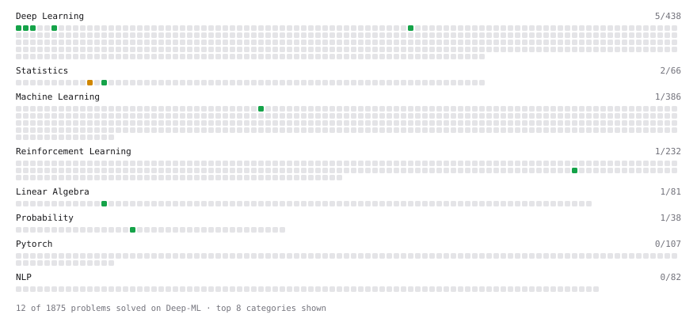

# Deep-ML

My machine learning practice from [Deep-ML](https://www.deep-ml.com). Every solution here was written by hand.

**27** solved · 27 problems · 0 labs · 0 math

[**Browse the interactive portfolio**](https://mobinaamrollahi.github.io/deep-ml/) to replay this filling in over time.

## Problems

| | Difficulty | Solved | |
| --- | --- | --- | --- |
| [Batch Iterator for Dataset](https://www.deep-ml.com/problems/30) | easy | 2026-11-03 | [solution](problems/0030-batch-iterator-for-dataset) |
| [Binary Classification with Logistic Regression](https://www.deep-ml.com/problems/104) | easy | 2026-10-07 | [solution](problems/0104-binary-classification-with-logistic-regression) |
| [Calculate Covariance Matrix](https://www.deep-ml.com/problems/10) | easy | 2026-11-07 | [solution](problems/0010-calculate-covariance-matrix) |
| [Calculate Mean by Row or Column](https://www.deep-ml.com/problems/4) | easy | 2026-11-07 | [solution](problems/0004-calculate-mean-by-row-or-column) |
| [Calculate P50/P95/P99 Latency Percentiles](https://www.deep-ml.com/problems/293) | easy | 2026-11-12 | [solution](problems/0293-calculate-p50-p95-p99-latency-percentiles) |
| [Compute Posterior Probability using Bayes' Theorem](https://www.deep-ml.com/problems/336) | easy | 2026-11-02 | [solution](problems/0336-compute-posterior-probability-using-bayes-theorem) |
| [Exponential Distribution PDF and CDF](https://www.deep-ml.com/problems/340) | easy | 2026-10-10 | [solution](problems/0340-exponential-distribution-pdf-and-cdf) |
| [Feature Scaling Implementation](https://www.deep-ml.com/problems/16) | easy | 2026-11-05 | [solution](problems/0016-feature-scaling-implementation) |
| [Gibbs Softmax Action Selection](https://www.deep-ml.com/problems/641) | easy | 2026-10-14 | [solution](problems/0641-gibbs-softmax-action-selection) |
| [Implementation of Log Softmax Function](https://www.deep-ml.com/problems/39) | easy | 2026-10-14 | [solution](problems/0039-implementation-of-log-softmax-function) |
| [L2 Normalization Along an Axis](https://www.deep-ml.com/problems/1022) | easy | 2026-11-05 | [solution](problems/1022-l2-normalization-along-an-axis) |
| [Matrix-Vector Dot Product](https://www.deep-ml.com/problems/1) | easy | 2026-11-05 | [solution](problems/0001-matrix-vector-dot-product) |
| [Min-Max Scaling of Feature Values](https://www.deep-ml.com/problems/112) | easy | 2026-11-12 | [solution](problems/0112-min-max-scaling-of-feature-values) |
| [One-Hot Encoding of Nominal Values](https://www.deep-ml.com/problems/34) | easy | 2026-11-03 | [solution](problems/0034-one-hot-encoding-of-nominal-values) |
| [Random Shuffle of Dataset](https://www.deep-ml.com/problems/29) | easy | 2026-11-03 | [solution](problems/0029-random-shuffle-of-dataset) |
| [Reshape Matrix](https://www.deep-ml.com/problems/3) | easy | 2026-11-07 | [solution](problems/0003-reshape-matrix) |
| [Scalar Multiplication of a Matrix](https://www.deep-ml.com/problems/5) | easy | 2026-11-12 | [solution](problems/0005-scalar-multiplication-of-a-matrix) |
| [Sigmoid Activation Function Understanding](https://www.deep-ml.com/problems/22) | easy | 2026-10-07 | [solution](problems/0022-sigmoid-activation-function-understanding) |
| [Single Neuron](https://www.deep-ml.com/problems/24) | easy | 2026-10-08 | [solution](problems/0024-single-neuron) |
| [Softmax Activation Function Implementation ](https://www.deep-ml.com/problems/23) | easy | 2026-10-07 | [solution](problems/0023-softmax-activation-function-implementation) |
| [Tensor Puzzle: Stack Two Vectors as Rows](https://www.deep-ml.com/problems/1276) | easy | 2026-11-12 | [solution](problems/1276-tensor-puzzle-stack-two-vectors-as-rows) |
| [Thanksgiving Feast Predictor: Softmax for Dish Selection](https://www.deep-ml.com/problems/216) | easy | 2026-10-14 | [solution](problems/0216-thanksgiving-feast-predictor-softmax-for-dish-selection) |
| [Transformation Matrix from Basis B to C](https://www.deep-ml.com/problems/27) | easy | 2026-10-08 | [solution](problems/0027-transformation-matrix-from-basis-b-to-c) |
| [Transpose of a Matrix](https://www.deep-ml.com/problems/2) | easy | 2026-11-07 | [solution](problems/0002-transpose-of-a-matrix) |
| [Vector Element-wise Sum](https://www.deep-ml.com/problems/121) | easy | 2026-11-05 | [solution](problems/0121-vector-element-wise-sum) |
| [Maximum Likelihood Estimation for Gaussian Distribution](https://www.deep-ml.com/problems/337) | medium | 2026-10-06 | [solution](problems/0337-maximum-likelihood-estimation-for-gaussian-distribution) |
| [Newton's Method for Optimization](https://www.deep-ml.com/problems/221) | medium | 2026-10-06 | [solution](problems/0221-newton-s-method-for-optimization) |

---

_This file is regenerated by Deep-ML on every push._
